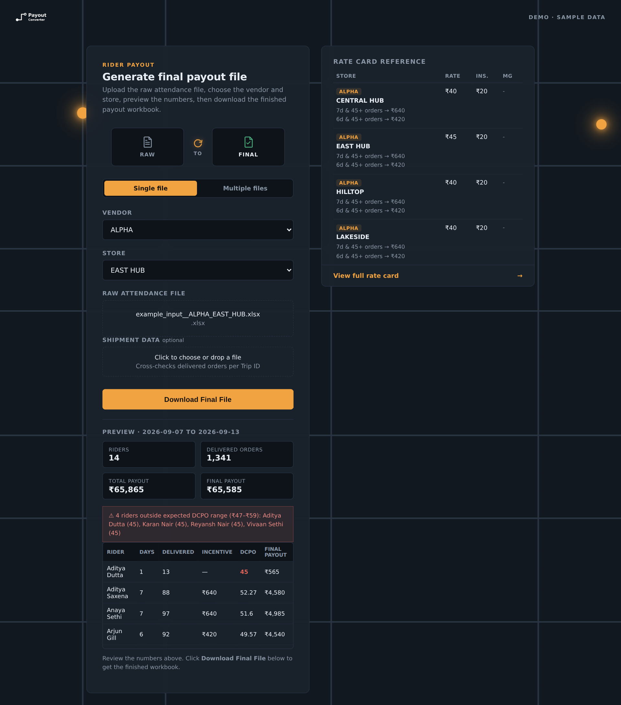
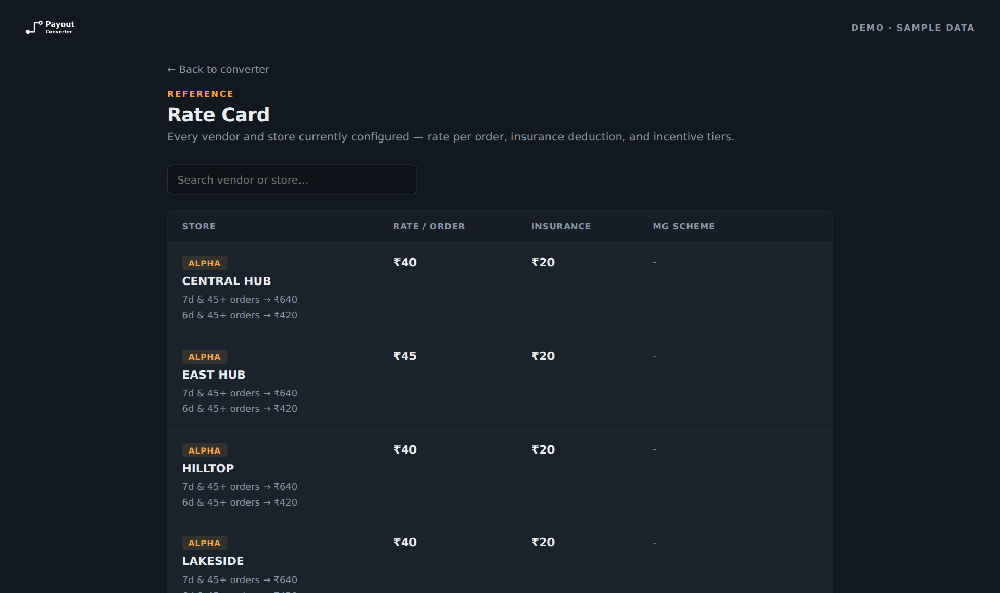

# Rider Payout Converter

Built during my internship at Zippee, where I used it to turn the weekly rider attendance files from our delivery vendors into finished payout sheets. This repo is a sanitized version I rebuilt for my portfolio: same code and logic, with the real client names, store names, and rate cards replaced by fictional sample data.

A small Flask web app that turns a raw weekly rider attendance/trip spreadsheet into a finished, formatted payout workbook — applying a different payout formula per vendor and store.

Upload the raw file, pick a vendor and store, preview the numbers, and download the final Excel workbook. Bulk mode processes many files at once and returns a ZIP.



> **All vendor names, store names, rider names and amounts in this repository are fictional sample data.** The project was originally built for a real payout workflow at Zippee; the real client names, locations and rate cards have been replaced with generated placeholders so it can be shared publicly. See [`sample_data/`](sample_data/) for how the sample data is generated.

## Features

- **11 payout schemes behind one interface** (across 13 sample vendors) — per-order rates, attendance-based incentive tiers, minimum-guarantee (MG) schemes, flat per-day/per-trip pay, distance-based pay, and cancelled-order pay. See the [table below](#payout-models).
- **Preview before download** — per-rider attendance, orders, incentive, insurance deduction and final payout, with totals.
- **Outlier flagging** — riders whose delivery-cost-per-order (DCPO) falls outside a store's expected range are highlighted.
- **Shipment cross-check** (optional) — upload a shipment/tracking file and every trip's delivered count is checked against it, marked green (ok) or red (mismatch / not found).
- **Bulk mode** — process many files in one go; failures are reported in a `FAILURES.txt` inside the ZIP instead of aborting the batch.
- **Forgiving input handling** — columns are detected by keyword (`"RIDER NAME"` vs `"RIDER NAME / Emp. Code"` both work), absent-marked rows (`A`) are ignored, and mixed date formats are normalised.
- **Actionable errors** — a missing column tells you which columns were expected and which were actually found.
- **Auditable output** — trip-level payouts and totals are written as real Excel formulas, so the workbook can be checked and edited by hand.
- **Rate card page** — a searchable reference of every configured vendor/store, generated from the same config the engine uses.

## Quick start

```bash
pip install -r requirements.txt
python app.py
```

Open <http://localhost:5000>.

To try it immediately, use the ready-made files in [`sample_data/`](sample_data/):

1. Choose vendor **ALPHA**, store **NORTH HUB**.
2. Upload `sample_data/raw/ALPHA__NORTH_HUB.xlsx`.
3. Click **Preview**, then **Generate**.
4. Optionally attach `sample_data/shipments_week.xlsx` to see the shipment cross-check columns.

Every file in `sample_data/raw/` is named `VENDOR__STORE.xlsx` so you can match it to the dropdowns. For bulk mode, add all of them and pick the vendor/store per row.

Only `.xlsx` files are accepted (the engine reads workbooks with openpyxl, which can't open the legacy `.xls` format). If you have an `.xls` file, open it in Excel and use *Save As → .xlsx* first.

By default the app only listens on `localhost`, since it has no login and accepts file uploads. To let others on your network use it, opt in explicitly:

```bash
HOST=0.0.0.0 python app.py
```

### Running the tests

```bash
python -m unittest discover -s tests -v
```

The suite runs the converter against every sample file and the worked example, checking the output against an independent recalculation done with pandas — not just that it runs without error. It also exercises the Flask routes directly: preview, generate, bulk mode, and the input-validation paths (wrong file type, unknown vendor/store, missing columns).

### Command line

The engine also works without the web app:

```bash
python payout_engine.py sample_data/raw/ALPHA__NORTH_HUB.xlsx out.xlsx --company ALPHA --store "NORTH HUB"

# override a store's numbers (new/unlisted store)
python payout_engine.py raw.xlsx out.xlsx --company ALPHA --store LAKESIDE \
    --rate 40 --insurance 20 --tiers "7:45:640,6:45:420"
```

## Worked example: input → output

[`sample_data/example/`](sample_data/example/) holds a complete before/after pair for vendor **ALPHA**, store **EAST HUB** (one week, 14 riders, 101 trips):

| File | What it is |
| --- | --- |
| `example_input__ALPHA_EAST_HUB.xlsx` | The raw export: `Sheet1` (one row per trip, 19 columns) plus `Sheet2`, a manual per-rider calculation kept alongside it |
| `example_output__ALPHA_EAST_HUB.xlsx` | What the converter produces from it: `PAYOUT`, `PAYOUT DATA`, `FINAL PAYOUT` |

The output workbook has three tabs:

- **`PAYOUT`** — the raw trips unchanged, plus a `PAYOUT` column (`=delivered orders × rate`) on every row.
- **`PAYOUT DATA`** — an untouched copy of the input's `Sheet2`, for reference only. The converter never uses it in a calculation.
- **`FINAL PAYOUT`** — the per-rider rollup, computed independently from the trips:

| Rider | Days | Orders | Incentive | Payout | Total payout | Insurance | Final payout | DCPO |
| --- | ---: | ---: | ---: | ---: | ---: | ---: | ---: | ---: |
| Aditya Dutta | 1 | 13 | 0 | 585 | 585 | 20 | 565 | 45 |
| Aditya Saxena | 7 | 88 | 640 | 3,960 | 4,600 | 20 | 4,580 | 52 |
| Anaya Sethi | 7 | 97 | 640 | 4,365 | 5,005 | 20 | 4,985 | 52 |
| Arjun Gill | 6 | 92 | 420 | 4,140 | 4,560 | 20 | 4,540 | 50 |
| Arjun Pillai | 6 | 123 | 420 | 5,535 | 5,955 | 20 | 5,935 | 48 |
| Ayaan Kapoor | 7 | 175 | 640 | 7,875 | 8,515 | 20 | 8,495 | 49 |
| Karan Nair | 6 | 41 | 0 | 1,845 | 1,845 | 20 | 1,825 | 45 |
| Manav Kapoor | 7 | 148 | 640 | 6,660 | 7,300 | 20 | 7,280 | 49 |
| Neel Bose | 7 | 131 | 640 | 5,895 | 6,535 | 20 | 6,515 | 50 |
| Reyansh Nair | 3 | 33 | 0 | 1,485 | 1,485 | 20 | 1,465 | 45 |
| Tarun Saxena | 7 | 160 | 640 | 7,200 | 7,840 | 20 | 7,820 | 49 |
| Varun Nair | 6 | 104 | 420 | 4,680 | 5,100 | 20 | 5,080 | 49 |
| Vivaan Sethi | 5 | 64 | 0 | 2,880 | 2,880 | 20 | 2,860 | 45 |
| Zoya Bhatt | 6 | 72 | 420 | 3,240 | 3,660 | 20 | 3,640 | 51 |
| **TOTAL** |  | **1,341** | **5,520** | **60,345** | **65,865** | **280** | **65,585** | **49** |

Things to notice in the example: the rider with too few orders for a tier gets no incentive even with enough days, and riders with fewer than six days get none regardless of volume. Under the sample rate card, incentives are ₹640 (7 days and 45+ orders) and ₹420 (6 days and 45+ orders). The numbers were recomputed independently from the input trips and match the converter's output for every rider.

## Payout models

Each vendor in `COMPANY_CONFIG` uses one of these models. (Vendors are sample data; the models are the interesting part.)

| Vendor | Model | Output tabs |
| --- | --- | --- |
| ALPHA, IOTA | Per-order rate + incentive tiers + flat insurance, with a per-rider `FINAL PAYOUT` rollup and DCPO | `PAYOUT`, `PAYOUT DATA`, `FINAL PAYOUT` |
| BETA | Per-order rate + incentive tiers + insurance; some stores also have MG riders on a separate sheet | `PAYOUT` (or `MG ORDERS` + `PER ORDER`), `INCENTIVE`, `INSURANCE DEDUCTION` |
| GAMMA | Distance-based (flat amount + per-km) for some stores, per-order + tiers for others; can exclude riders belonging to another vendor via an attendance sheet | `PAYOUT`, `INSURANCE DEDUCTION` (+ `INCENTIVE`) |
| DELTA | Per-order rate with optional MG sheet and/or incentive tiers; no insurance | `PAYOUT` / `MG ORDERS` + `PER ORDER`, `INCENTIVE` |
| EPSILON GROUP | Minimum guarantee applied to **each trip**: flat base up to N orders, then a per-order rate beyond that | `PAYOUT`, `INSURANCE DEDUCTION` |
| ZETA | Delivered orders × rate + cancelled orders × cancelled rate | `PAYOUT` |
| THETA | Same as ZETA, plus incentive tiers | `PAYOUT`, `INCENTIVE` |
| KAPPA | Flat amount per day present; attendance and bank-detail sheets are carried through | `PAYOUT DATA`, `FINAL PAYOUT`, `ATTENDANCE SHEET`, `BANK AC DETAILS` |
| LAMBDA | Flat amount per trip, no insurance | `PAYOUT` |
| OMEGA | Flat amount per trip + insurance | `PAYOUT`, `INSURANCE DEDUCTION` |
| SIGMA | Flat amount per trip + per-km distance bonus | `PAYOUT`, `INSURANCE DEDUCTION` |
| TAU | Per-order rate + insurance; rows with no trip ID are dropped | `PAYOUT`, `INSURANCE DEDUCTION` |

**Incentive tiers** are `(min login days, min delivered orders, amount)`: a rider earns the highest tier for which they meet *both* thresholds.

## Expected raw file format

The first sheet should contain one row per rider-trip. Columns are matched by keyword, so exact wording and order don't matter.

| Column (keyword match) | Required | Notes |
| --- | --- | --- |
| `DATE` | yes | Distinct dates per rider = attendance days |
| `RIDER NAME` | yes | |
| `TOTAL DELIVERED ORDERS` | yes | |
| `TRIP ID` | no | Needed for the shipment cross-check; combined IDs like `123/456` are supported |
| `IN TIME` / `OUT TIME` | no | `A` / `ABSENT` / `LEAVE` marks the row as an absence and it is ignored |
| `TOTAL CANCELLED ORDERS` | ZETA, THETA | |
| `DISTANCE` | GAMMA (distance stores), SIGMA | |

Real exports usually carry more columns than this. The worked example uses a full 19-column export (`TRIP ID`, `RIDER ID`, `STORE NAME`, working hours, assigned/undelivered orders, delivery percentage, remarks, meter readings, …). Everything the converter doesn't need is ignored and carried through as-is.

Stores with an MG scheme expect a second sheet whose name contains `MG`. See [`sample_data/raw/`](sample_data/raw/) for a minimal working file for every vendor/store, and [`sample_data/example/`](sample_data/example/) for a full-layout one.

## Adding a vendor or store

Everything lives in `COMPANY_CONFIG` at the top of [`payout_engine.py`](payout_engine.py). Add an entry, restart the app, and it appears in the dropdowns and on the rate card automatically:

```python
COMPANY_CONFIG = {
    'ALPHA': {
        'NEW STORE': {'rate': 40, 'insurance': 20, 'tiers': [(7, 45, 640), (6, 45, 420)]},
    },
    'MY VENDOR': {
        'SOME STORE': {'rate': 45, 'insurance': 0, 'mg': {'base': 620, 'threshold': 12, 'rate': 45}},
    },
}
```

The keys in a store's entry select its payout model (`rate`, `tiers`, `mg`, `mg_per_trip`, `distance_mg`, `flat_per_day`, `cancelled_rate`, …); the config block's comments describe each one.

> A vendor with a *new kind* of payout formula needs a small builder function in `payout_engine.py` plus a branch in `build()` / `preview_summary()`. The existing `build_*` functions are short and are good templates.

## Regenerating the sample data

The sample files are produced by a seeded script, so they're reproducible:

```bash
python sample_data/generate_sample_data.py
```

It reads `COMPANY_CONFIG`, so it stays in sync if you add or change vendors and stores. The worked example's output is produced by running the actual converter on its input. Rider names, trip IDs, orders and distances are all randomly generated; the bank-details sheet uses obviously fake placeholders.

The rate card page (`/rate-card`) lists every configured vendor/store with a live search, generated from the same `COMPANY_CONFIG`:



## Project structure

```
.
├── app.py                      # Flask routes: preview, generate, bulk, rate card
├── payout_engine.py            # Config + all payout logic + CLI
├── templates/                  # index.html (converter), rate_card.html
├── static/logo.png
├── sample_data/
│   ├── generate_sample_data.py
│   ├── shipments_week.xlsx     # shared shipment file for the cross-check
│   ├── example/                # worked input -> output pair (ALPHA / EAST HUB)
│   └── raw/                    # one minimal sample raw file per vendor/store
├── tests/
│   └── test_payout_converter.py
├── docs/                       # README screenshots
└── requirements.txt
```

## Sharing on a local network

Start it with `HOST=0.0.0.0 python app.py` and others on the same network can open `http://<your-ip>:5000` (find your IP with `ipconfig` on Windows or `ifconfig` / `ip addr` on macOS/Linux). Uploaded files and generated workbooks are deleted automatically after 24 hours.

This is a development server intended for local use, and there's no login — anyone who can reach the address can upload files and download whatever they generate. If you deploy it somewhere more public, put it behind proper authentication first.

## What I learned

The hard part wasn't any single payout formula — it was that every vendor's raw export was shaped slightly differently, and the tool had to be forgiving about it. A few things that came up repeatedly:

- **Column matching by keyword, not exact name.** Different vendors' exports call the same thing `"RIDER NAME"`, `"Rider Name"`, or `"RIDER NAME / Emp. Code"`. Matching on keywords instead of exact headers meant one new export format usually didn't need a code change.
- **Dates are never as clean as they look.** The same file can mix real Excel date cells with text dates in a different format for a handful of rows. Comparing them as strings silently double-counts a rider's attendance; normalising to actual dates first was the fix.
- **A working demo needs its own realistic data.** Sanitizing the real project for this repo meant not just renaming things, but building a sample-data generator so the demo is actually usable end to end, and a worked example with numbers I could verify by hand.
- **Testing against an independent calculation, not just "it doesn't crash."** The test suite recomputes each rider's payout with plain pandas from the raw trips and checks it against the workbook the converter produces — that catches wrong numbers, not just exceptions.

## Tech

Python · Flask · pandas · openpyxl
